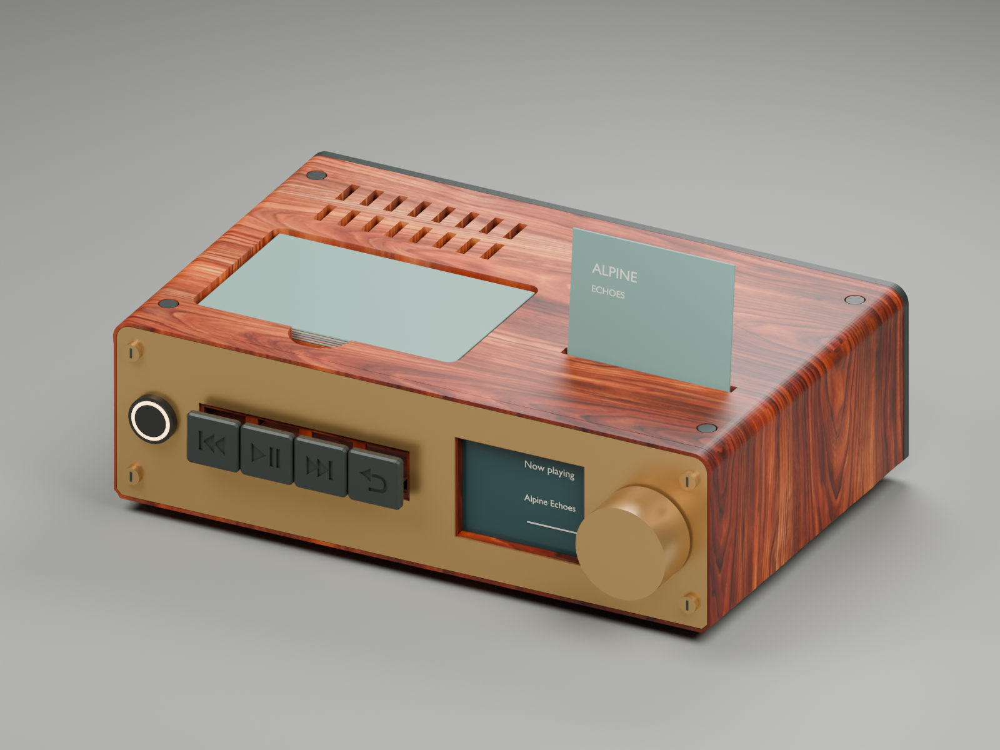

# NFC Album Player

A tabletop music player where each album is a card. Put a card in the slot and its album plays; take it out and it pauses. It is built for a Hi-Fi shelf: a proper DAC, a screen, a knob, and local storage for a whole collection.



*Render of the case design, made from the same model as its printable parts. The case has not been printed yet; the real build is currently parts on a bench.*

## What it does

- **Cards are albums.** Blank NFC cards are linked to albums on the device itself. A card remembers where it stopped. A card can also play a whole artist, or a list: a folder of songs from different albums.
- **Hi-Fi output.** A Raspberry Pi DAC Pro provides 3.5 mm and RCA outputs, with a balanced output available for a 4.4 mm socket.
- **Screen and controls.** A 2-inch display shows the cover, track and time. A clicky knob sets the volume and scrolls lists; four buttons do previous, play/pause, next and back. A power key shuts the player down safely: the screen shows **Turning off**, and it is safe to unplug 15 seconds later.
- **Music over USB.** Plug the player into a computer and its music appears as a drive called `MUSIC`.
- **Web remote.** A page served by the player controls playback, links cards, and uploads or deletes music from any phone or computer on the same Wi-Fi.

## Hardware

| Part | Used here |
|---|---|
| Computer | Raspberry Pi Zero 2 W |
| DAC | Raspberry Pi DAC Pro |
| Display | 2-inch ST7789 SPI LCD, 320×240 |
| NFC reader | PN532 over SPI, with NTAG215 cards |
| Knob | 24-click rotary encoder with push switch |
| Buttons | Five momentary push buttons: four for playback, one for power |

The full parts list, wiring diagrams and step-by-step instructions are in the build guide, [docs/index.html](docs/index.html). GitHub shows that file as source, so open it in a browser from a local copy.

## Status

This is a work in progress.

- The player logic, screens, web remote and MPD playback run and are tested on a Mac, using a browser simulator in place of the hardware.
- On a real Pi, setup and the web remote have been run. The display, NFC reader, knob, buttons and USB drive mode were written without the hardware and are not yet proven.
- The case is designed but not yet printed. Its printable parts, drawings and assembly guide are in [NFC-Player-Case](NFC-Player-Case); open `NFC-Player-Assembly.html` there in a browser.

## Try it without any hardware

The simulator shows the display and stands in for the knob, buttons, cards, headphone jack and USB port.

```sh
python3 -m venv .venv
.venv/bin/pip install pillow numpy python-mpd2 pytest
.venv/bin/python -m player.demo_library demo/music
.venv/bin/python -m player.main --sim
```

Add `mutagen` to the `pip install` line if you point the simulator at your own tagged music with `--music`; without it, albums come from folder names only. On the Pi the tags come from MPD and nothing extra is needed.

Then open `http://localhost:8137` for the simulated device and `http://localhost:8080` for the web remote. The demo library is generated sine tones, and the simulator is silent unless you run it against MPD (`system/mpd-dev.sh`, then add `--playback mpd`).

Run the tests with:

```sh
.venv/bin/python -m pytest
```

## How it is put together

- `player/app.py` is the player's behaviour: a state machine fed with events from cards, controls, USB and the web.
- `player/ui/render.py` draws the screens.
- `player/hw/` holds the drivers (display, NFC reader, knob and buttons, USB drive mode), a simulator, and bring-up checks for each part.
- `player/web/` is the web remote.
- `player/playback.py` talks to [MPD](https://www.musicpd.org/), which does the decoding and audio output.
- `system/` has the Raspberry Pi setup script and service files.
- `NFC-Player-Case/` is the 3D-printed case. Every dimension is in `case.py`; Blender scripts build the STLs, pictures and assembly guide from it.

## A note on the web remote

The web remote has no password. Anyone on the same network can control playback and add or delete music. Use it on a home network you trust, or turn it off with `--web-port 0`.
